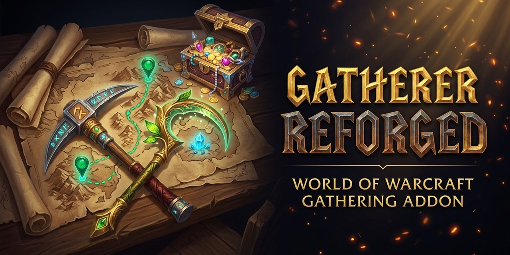

  

  # Gatherer Reforged

  **The legendary 2005 *Gatherer* addon by Norganna (last updated in 2017) — finally reforged for modern World of Warcraft!**

  
  
  
  
  
  
  
  

---

Every long-time World of Warcraft veteran remembers **Norganna's legendary *Gatherer***—one of WoW's original and most iconic addons, first created back in **2005 (Vanilla WoW)** and maintained by *Norganna's AddOns* until its last official release in **September 2017 (*Legion* Patch 7.3)**.

After **more than 20 years** since its birth in Vanilla and nearly a decade without an official update, **Gatherer Reforged** brings this classic back from the ashes! Completely modernized and rebuilt from the ground up with a native **`C_Map` mapping engine**, a modern **Ace3 configuration interface**, a **redesigned Dark-Gold Report & Search UI**, a **Cross-Addon Live Sharing Bridge**, and the iconic **3D Heads-Up Display (HUD)** integrated directly into the core addon, it tracks your **Herbalism**, **Mining**, **Treasure**, **Fishing**, **Gas Cloud**, and **Archaeology** nodes across **Retail (*The War Within* / *Midnight*)**, **WoW Forever**, and all **Classic** flavors.

---

## ✨ Key Features

- 🏛️ **The Classic Legend, Rebuilt for Modern WoW**: Preserves everything old-school WoW players loved about Norganna's *Gatherer* (per-node harvest history, drop percentages, guild/party node sync, and the 3D HUD) while stripping out all broken legacy libraries (`Astrolabe`, `Babylonian`, `DongleStub`, `SlideBar`, `!Swatter`).
- 🧭 **Integrated 3D Heads-Up Display (HUD)**: The famous *Gatherer HUD* plugin is now built right into the main addon—projecting a customizable 3D compass overlay in the center of your screen with distance, angle, pitch, heat-trail tracking, and automatic hide conditions (combat, flying, mounted, inside instances).
- 🌿 **Comprehensive Node Tracking**: Automatically records exact coordinates, harvest counts, drop rates, inspection times, and sources for **Herbs**, **Mining Veins**, **Treasure Chests / Containers**, **Fishing Schools**, **Engineering Gas Clouds**, and **Archaeology** dig finds.
- 💰 **Live Session & Gold-per-Hour (GPH) Tracker**: Tracks nodes gathered, nodes/hour, total session loot value, and **Gold per Hour (GPH)** in real time—displayed in your **LDB DataSource bar** (*Titan Panel*, *Bazooka*, *ElvUI DataTexts*), the Minimap button tooltip, the Report sidebar, and Ace3 Options.
- ⏱️ **Respawn Cooldown Dimming**: Recently harvested nodes are automatically dimmed on the Minimap and 3D HUD for a configurable respawn duration (default 5 minutes) so you always know which nodes on your farming route are still on cooldown.
- 🔮 **Dynamic "Forever" Node Discovery**: Automatically learns and persists brand-new or custom herbs, ores, and treasures in current and future expansions or custom realms (such as *WoW Forever*) without waiting for static database updates.
- 🗺️ **Native `C_Map` Engine**: Built directly on Blizzard's modern `C_Map` and `C_Minimap` APIs with full support for zone, continent, and world-level node projection.
- 🖥️ **Modern Dark-Gold Gatherables Report & Node Density Search UI**:
  - Sleek `1px`-bordered dark-gold interface (`Gatherer.UIStyle`) with live search, filter pills, and **1-click profession category tabs** (*All, Herbs, Mining, Treasures, Archaeology*).
  - **Sortable columns** (`Node`, `Zone`, `Coordinates`, `Distance`, `Live Market Value`, `Source`) and **visual density progress bars** in the Zone Density Search window.
  - **Left-Click** a row to mark/unmark for batch transfer or deletion; **Right-Click** (or `Shift+Click`) any row to set a **TomTom or Blizzard Map Waypoint** directly to that node.

---

## 🌉 Cross-Addon Live Node Sharing Bridge

Guilds and raid groups often use a mix of different gathering addons. **Gatherer Reforged** includes a built-in **Cross-Addon Sharing Bridge** that automatically **receives AND broadcasts** newly discovered nodes across all major gathering addon protocols in Guild, Party, Raid, and Instance channels (with intelligent self-echo suppression including multi-word character surnames):

| Addon / Protocol | Prefix | Direction | Description |
| :--- | :--- | :--- | :--- |
| **Gatherer Reforged & Classic Gatherer** | `GathX` / `Gatherer` | bidirectional (`⇄`) | Native Gatherer protocol, enhanced to automatically register dynamic/custom nodes across clients, plus whisper mass-sharing. |
| **Gatherer Reborn** | `GRBNode` | bidirectional (`⇄`) | Full support for *Gatherer Reborn*'s tab-delimited live sync (`1\t<zone>\t<nodeType>\t<coords>\t<nodeID>`) + local `GathererReborn*DB` import & live sync. |
| **GatherMate_Sharing / GatherMate2_Sharing** | `GM2SD` / `GMSD` | bidirectional (`⇄`) | Exact protocol match (`A:<zone>:<dbIndex 1..7>:<coord>:<nodeID>`), acting as a modern replacement for the discontinued *GatherMate_Sharing* addon. |
| **GatherLite** | `GATHERLITE` / `G2G` | receive (`←`) | Decodes both `AceSerializer-3.0` and delimited node broadcasts from *GatherLite* users. |
| **Local `GatherMate2` & `Gatherer Reborn`** | Local API Hook | bidirectional (`⇄`) | Two-way live sync (`AddNodeChecked` / `InjectNode2` & `AddNode` hook) when running alongside a local *GatherMate2* or *Gatherer Reborn* installation. |

---

## 🧩 Full Map, Economy & UI Addon Compatibility

Gatherer Reforged works seamlessly alongside modern UI, map, and farming addons:

- **1-Click `GatherMate2`, `GatherMate2_Data` & `Gatherer Reborn` Importer**: Built-in importer (`/gather import`, in the *Integrations & DB* options tab, or directly inside the *Gatherables Report*) to import your saved `GatherMate2` / `GathererReborn` databases and pre-populated Wowhead databases from `GatherMate2_Data` & `GatherMate2Storage_*` (*Classic*, *TBC*, *Wrath*, *Dragonflight*, *The War Within*, *Midnight*, and *WoW Forever*).
- **Auctionator, TradeSkillMaster (TSM), OribosExchange & RECrystallize**: Displays live Auction House market values per herb/ore directly inside World Map / Minimap node tooltips and in the *Gatherables Report* table.
- **Routes & FarmHud**: Registers `GathererReforged` as a native data source in **Routes** (for automated TSP farming circuits) and automatically reparents Minimap pins when **FarmHud** is toggled.
- **MapWise**: Full support for MapWise's custom **Terrain** and **Paper** rendering modes (`MapWiseAPI`), continent/Azeroth projections, and automatic integration into MapWise's **"Addons"** toolbar menu.
- **ElvUI**: Native support for **Square** and **Round** minimaps (`GetMinimapShape()`), click-passthrough for ElvUI's right-click tracking & middle-click micro menus, and scaled World Map support.
- **Leatrix Maps / SexyMap / BasicMinimap / Chinchilla**: Dynamic frame layering above map reveal overlays and full support for all custom minimap shapes (`SQUARE`, `ROUND`, `CORNER-*`, `SIDE-*`, `TRICORNER-*`).
- **TomTom & Native Waypoints**: `Shift + Right-Click` or `Alt + Left-Click` any Gatherer pin on the World Map (or `Right-Click` any row in the Gatherables Report) to create a **TomTom** waypoint or native Blizzard map pin.
- **LibDBIcon-1.0, LibDataBroker-1.1 & Addon Compartment**: Works with LDB bars (*Bazooka*, *Titan Panel*, *ElvUI DataTexts*), *ElvUI WindTools* button bars, and Retail's Minimap Addon Compartment.

---

## 🎮 Supported WoW Versions

- **WoW Forever** (`16001`)
- **Retail / Midnight** (`12.x`)
- **Mists of Pandaria Classic** (`5.5.x`)
- **Cataclysm Classic** (`4.4.x`) & **Wrath Classic** (`3.4.x` / `3.8.x`)
- **Burning Crusade Classic Anniversary** (`2.5.x`)
- **Classic Era** (`1.15.x`)

---

## ⌨️ Slash Commands

Use `/gather`, `/gatherer`, `/gathererreforged`, or `/greforged`:

| Command | Description |
| :--- | :--- |
| `/gather` or `/gather options` | Open the Ace3 configuration window |
| `/gather report` | Open the Gatherables Report dialog |
| `/gather search` | Open the Node Density & Zone Search dialog |
| `/gather import` | Import `GatherMate2`, `GatherMate2_Data` & `Gatherer Reborn` databases |
| `/gather session` | Print current session statistics and Gold/Hour (GPH) |
| `/gather reset` | Reset current session statistics |
| `/gather on` / `/gather off` / `/gather toggle` | Enable, disable, or toggle Minimap tracking |
| `/gather dist <yards>` | Set maximum Minimap tracking distance |
| `/gather num <count>` | Set maximum number of Minimap notes displayed |
| `/gather herbs on\|off\|toggle` | Toggle Herbalism node display |
| `/gather mining on\|off\|toggle` | Toggle Mining node display |
| `/gather open on\|off\|toggle` | Toggle Treasure / Container node display |

---

## 📜 Credits & License

- **Original Addon (2005–2017)**: Norganna (*Norganna's AddOns*)
- **Reforged Modernization**: **gOOvER** ([goover.dev](https://www.goover.dev))
- **License**: [GNU General Public License v3.0 (GPL-3.0)](LICENSE)
- **Support Development**: [donate.goover.dev](https://donate.goover.dev) • [Ko-fi](https://ko-fi.com/oldnoob) • [Buy Me a Coffee](https://www.buymeacoffee.com/goover)
